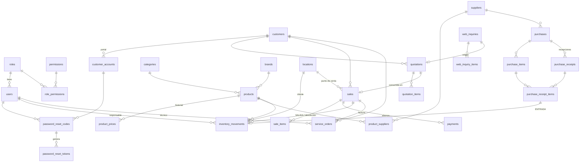

# Base de datos de SIVEN

PostgreSQL 13 o superior, administrada con **Prisma 7** (`prisma/schema.prisma` + migraciones SQL).
Este documento explica el diseño, las decisiones y cómo aplicar la migración
`20261027040000_mejoras_base_de_datos`, que lleva la base a lo que piden el **Análisis de mejoras**
(P0–P3) y el **Prompt Maestro** (PK, FK, UNIQUE, NOT NULL, CHECK e índices).

| | Cantidad |
| --- | --- |
| Tablas | 31 |
| Tipos enumerados | 12 |
| Llaves foráneas | 52 |
| Restricciones CHECK | 75 |
| Índices (incluye PK y únicos) | 127 |
| Triggers | 4 |

---

## 1. Qué cambió y por qué

| Mejora del análisis | Cambio en la base |
| --- | --- |
| **P0** · Alta de producto sin precio, costo ni stock | El precio ya no es obligatorio al crear; `product_prices` guarda el historial (trigger) y solo `prices:write` (Administración/Gerencia) lo fija. Stock y costo solo cambian con `inventory_movements`. |
| **P0** · Sin IVA rígido (cuota fija) | `system_config.TAX_RATE = 0`, `TAX_REGIME = CUOTA_FIJA`. Cada cotización y venta guarda la **tasa aplicada** (`tax_rate`), así el historial no cambia si cambia la configuración. |
| **P0** · Bodega y sucursal sin multialmacén | Tabla `locations` con 2 filas fijas (1 = Bodega, 2 = Sucursal). Las existencias siguen consolidadas; movimientos, ventas y recepciones registran **dónde** ocurrieron. |
| **P0** · Solicitudes web auditables | `web_inquiries` gana código `SOL-000001`, estados Nueva → En revisión → Cotizada → Cerrada / Cancelada, responsable, cliente y sus líneas (`web_inquiry_items`). Nunca se borran. |
| **P1** · Compras y recepción | `purchases`, `purchase_items`, `purchase_receipts`, `purchase_receipt_items`. Cada línea recibida genera una ENTRADA enlazada 1:1 (`inventory_movements.purchase_receipt_item_id`). Soporta recepción parcial, moneda (C$/US$) con tipo de cambio y gastos adicionales. |
| **P1** · Reabastecimiento | `products.max_stock` (tope de reposición), `restock_postponed_until` ("Posponer") y `product_suppliers` (proveedor preferente, último costo, plazo de entrega). |
| **P1** · Login de clientes y portal | `customer_accounts` (login externo, separado del personal) ligado a `customers`. |
| **P1** · Solicitud → Cotización | `quotations.inquiry_id` (1:1) conserva el origen. |
| **P2** · Antigüedad y pipeline | `quotations.status_changed_at`, `rejection_reason`; índice parcial de cuentas por cobrar por vencimiento. |
| **P3** · Código de barras, foto, unidad | `products.barcode` (único), `image_url`, `unit`. |
| Login con correo | `users.email` ya existía: ahora en minúsculas con CHECK, y el login acepta usuario **o** correo. |
| Recuperación de contraseña | `password_reset_codes` y `password_reset_tokens` (los modelos de la guía), solo con **hash**; `users.password_changed_at` invalida las sesiones anteriores. |
| Trazabilidad | `inventory_movements.sale_id` reemplaza el par texto `source_entity/source_id` por una FK real. |

## 2. Diagrama entidad-relación



La cadena del análisis queda completa en la base:
**SOL → COT → FAC → Pago** y **Compra → Recepción → Entrada de inventario**.

## 3. Convenciones y decisiones

- **Nombres.** Tablas y columnas en `snake_case` (vía `@@map`/`@map`); en TypeScript, `camelCase`.
  Se corrigió `role_permissions`, que tenía columnas `roleId`/`permissionId` (renombradas sin perder datos).
- **Claves.** UUID **v7** (`@default(uuid(7))`): ordenadas por tiempo, lo que mantiene compactos los
  índices de tablas que crecen mucho (auditoría, movimientos). `locations` usa `SMALLINT` por ser
  una tabla de referencia de dos filas.
- **Fechas en `TIMESTAMPTZ(3)`.** Antes eran `TIMESTAMP` sin zona. Ahora cada valor es un instante
  absoluto; los reportes lo convierten a hora de Nicaragua con `AT TIME ZONE 'America/Managua'`.
  - **Importante:** el adaptador de PostgreSQL de Prisma 7 lee mal `TIMESTAMPTZ` si la sesión no está
    en UTC (se comprobó: en un servidor con zona `America/Managua` corre las horas 6 h). Por eso
    `PrismaService` y el seed conectan con `options: '-c TimeZone=UTC'`. Si escribe otro script con
    Prisma, use la misma opción.
- **Dinero:** `DECIMAL(14,2)`; costos unitarios `DECIMAL(14,4)`; tasas `DECIMAL(5,4)`.
- **Llaves foráneas.** `RESTRICT` por defecto (no se borra un cliente con ventas, ni una venta con
  movimientos); `CASCADE` solo en las partes de un documento (líneas) y en datos derivados
  (historial de precios de un producto creado por error); `SET NULL` en referencias opcionales.
  Toda FK tiene índice.
- **Lo que Prisma no declara** vive en el SQL de la migración: restricciones `CHECK`, índices
  parciales y triggers. Se verificó con el motor de migraciones oficial que Prisma **no los borra**
  al comparar el esquema (un `migrate dev` posterior no genera cambios).

## 4. Reglas que la base garantiza (aunque falle la API)

| Tabla | Regla |
| --- | --- |
| `users` | usuario `^[a-z0-9._-]{3,50}$`; correo en minúsculas y con formato válido |
| `products` | SKU en mayúsculas; stock, mínimo, costo y precio ≥ 0; `max_stock ≥ min_stock` |
| `product_prices` | un solo precio vigente por producto (índice único parcial `WHERE valid_to IS NULL`) |
| `inventory_movements` | cantidad > 0; **el stock cuadra**: ENTRADA = antes + cantidad, SALIDA = antes − cantidad, AJUSTE = diferencia; proveedor y recepción solo en entradas; un solo documento de origen |
| `sales` | total = subtotal + impuesto; anulada ⇔ fecha y motivo de anulación; crédito ⇔ vencimiento; **estado de pago coherente con el saldo** (PAGADA ⇒ saldo 0, PENDIENTE ⇒ saldo = total, PARCIAL ⇒ entre ambos) |
| `quotations` | total = subtotal + impuesto; validez posterior a la emisión; tasa entre 0 y 1 |
| `quotation_items`, `sale_items` | subtotal = cantidad × precio; un producto por documento |
| `payments` | monto > 0; solo CASH o TRANSFER; transferencia con referencia |
| `service_orders` | técnico obligatorio desde ASIGNADA; fechas de inicio/fin según el estado; FACTURADA ⇔ venta; CANCELADA ⇔ fecha y motivo; fechas en orden |
| `purchases` | total = subtotal + gastos; en C$ el tipo de cambio es 1; ordenada ⇒ fecha de orden; cancelada ⇔ fecha y motivo |
| `purchase_items` | 0 ≤ recibido ≤ pedido; subtotal = cantidad × costo |
| `password_reset_*` | pertenece a un usuario **o** a una cuenta de cliente (no ambos); hash SHA-256 de 64 hex; vence después de crearse |
| `locations`, `product_suppliers` | una bodega y una sucursal predeterminadas; un proveedor preferente por producto |

**Triggers**

- `trg_products_price_history`: cada cambio de `products.sale_price` cierra el precio vigente y abre
  uno nuevo en `product_prices`. La API indica quién y por qué en la misma transacción
  (`set_config('app.user_id', …, true)` y `app.price_reason`); un cambio hecho a mano en pgAdmin
  también queda registrado.
- `trg_inventory_movements_append_only`, `trg_payments_append_only`, `trg_audit_logs_append_only`:
  esas tablas son **bitácoras de solo inserción**; una corrección es un registro nuevo. (Para una
  depuración planificada de auditoría, el dueño de la base puede usar `ALTER TABLE … DISABLE TRIGGER`.)

## 5. Diccionario de datos (resumen)

> En la propia base cada tabla tiene su `COMMENT` (visible en pgAdmin o con `\d+`).

| Tabla | Para qué sirve | Columnas clave |
| --- | --- | --- |
| `users` | Personal interno | `username`, `email` (únicos, minúsculas), `role_id`, `is_active`, `password_changed_at` |
| `roles`, `permissions`, `role_permissions` | Control de acceso por rol | código de rol (enum), permiso `módulo:acción` |
| `password_reset_codes` | Paso 2 de la recuperación | `code_hash`, `attempts`, `expires_at`, `used_at`, `sent_to` |
| `password_reset_tokens` | Paso 3 de la recuperación | `token_hash` (único), `code_id`, `expires_at`, `used_at` |
| `locations` | Bodega y sucursal | `code` (BOD/SUC), `type`, `is_default` |
| `categories`, `brands` | Catálogos | `name` (único), `is_active` |
| `products` | Datos maestros del repuesto | `sku`, `barcode`, `unit`, `sale_price` (vigente), `avg_cost`, `stock`, `min_stock`, `max_stock` |
| `product_prices` | Historial de precios | `price`, `valid_from`, `valid_to`, `changed_by_id`, `reason` |
| `product_suppliers` | Proveedores de cada producto | `supplier_sku`, `last_cost`, `currency`, `lead_time_days`, `is_preferred` |
| `customers` | Clientes | `name`, `ruc` (único), `email` |
| `customer_accounts` | Portal de clientes | `email` (único), `password_hash`, `customer_id` |
| `suppliers` | Proveedores | `name`, `tax_id` (único), `is_international`, `country` |
| `inventory_movements` | Bitácora de existencias | `type`, `quantity`, `unit_cost`, `stock_before/after`, `sale_id`, `purchase_receipt_item_id`, `location_id` |
| `purchases` · `purchase_items` | Órdenes de compra | `code` (OC-…), `status`, `currency`, `exchange_rate`, `additional_costs`; `quantity`, `received_quantity` |
| `purchase_receipts` · `purchase_receipt_items` | Recepciones | `code` (REC-…), `received_at`, `location_id`; `quantity`, `unit_cost` (en C$, con gastos) |
| `quotations` · `quotation_items` | Cotizaciones | `code` (COT-…), `status`, `tax_rate`, `status_changed_at`, `inquiry_id` |
| `sales` · `sale_items` | Ventas | `invoice_number` (FAC-…), `tax_rate`, `balance`, `payment_status`, `due_date`, `location_id`; `unit_cost` al vender |
| `payments` | Abonos | `amount`, `method`, `reference` |
| `service_orders` | Órdenes OPI | `code`, `status`, `technician_id`, `sale_id`, `cancelled_at`, `cancellation_reason` |
| `web_inquiries` · `web_inquiry_items` | Solicitudes del sitio público | `code` (SOL-…), `status`, `assigned_to_id`, `customer_id`; productos y cantidades |
| `document_sequences` | Numeración sin huecos | `key`, `last_value` (QUOTATION, INVOICE, SERVICE_ORDER, INQUIRY, …) |
| `audit_logs` | Auditoría (solo inserción) | `module`, `action`, `entity`, `entity_id`, `username`, `ip`, `metadata` |
| `system_config` | Parámetros del negocio | `TAX_RATE`, `TAX_REGIME`, `CREDIT_TERM_DAYS`, `COMPANY_*` |

## 6. La migración `20261027040000_mejoras_base_de_datos`

Se generó con el motor de migraciones **oficial de Prisma 7.10** y se completó a mano en los cinco
puntos donde el SQL automático **habría perdido o roto datos**:

1. `InquiryStatus`: Prisma recreaba el tipo y fallaba con las consultas en `ATTENDED`.
   → `RENAME VALUE 'ATTENDED' TO 'IN_REVIEW'` y `ADD VALUE` en el orden del esquema.
2. `role_permissions`: Prisma borraba las columnas y las creaba vacías (todos los roles sin permisos).
   → `RENAME COLUMN`.
3. Fechas: Prisma convertía a `TIMESTAMPTZ` sin indicar la zona; en un servidor con hora de Managua
   todo se habría corrido 6 horas. → `USING columna AT TIME ZONE 'UTC'`.
4. `inventory_movements`: Prisma borraba `source_entity/source_id` antes de poder pasarlos a `sale_id`.
   → se agrega la FK, se copian los datos y luego se borran las columnas viejas.
5. `web_inquiries`: `code` y `updated_at` NOT NULL sin valor fallaban con filas existentes.
   → se crean vacías, se llenan (SOL-000001… por fecha) y luego pasan a NOT NULL.

Además migra los datos existentes: tasa aplicada de cada documento, historial de precios inicial,
proveedores por producto deducidos de las entradas, motivo de las OPI canceladas (que estaba en
las notas), correos en minúsculas, ubicaciones, configuración de cuota fija y los permisos nuevos.

**Seguridad de la migración**

- Va en **una sola transacción**: si algo falla, la base queda exactamente como estaba.
- Antes de tocar nada verifica la versión de PostgreSQL y que no haya usuarios con el mismo correo
  o usuario sin distinguir mayúsculas (si los hay, se detiene con un mensaje claro).
- Respeta una tasa de IVA cambiada a mano: solo reemplaza el 0.15 inicial por 0.

### Cómo aplicarla

Primero vea en qué punto está su base:

```bash
cd backend
npm install                 # dependencias nuevas (nodemailer)
npx prisma migrate status
```

- **Solo falta `20261027040000_mejoras_base_de_datos`** → actualice conservando los datos:

  ```bash
  npx prisma migrate deploy   # aplica la migración nueva (una sola transacción)
  npx prisma generate         # regenera src/generated/prisma (obligatorio: el esquema cambió)
  npx prisma db seed          # opcional: idempotente; mantiene roles y permisos al día
  ```

- **Aparece una migración que no está en el repositorio** (por ejemplo `…_init`) **o una fallida**
  (errores P3018 / P3009): esa base no salió de estas migraciones. Con datos de prueba, rehágala:
  `npx prisma migrate reset` (borra todo), `npx prisma generate`, `npx prisma db seed` y, con la API
  corriendo, `node scripts/seed-demo.mjs`.

`npm run build` (`nest build`) no regenera el cliente: después de cambiar `schema.prisma` siempre va
`npx prisma generate`.

## 7. Cómo se probó

- **Sin drift:** el motor oficial aplica todas las migraciones en una base temporal y la compara con
  `schema.prisma` → *No difference detected*.
- **Actualización con datos reales**, con el servidor en zona `America/Managua`: mismos conteos,
  mismos instantes (al segundo) y mismos montos antes y después; la base resultante coincide con el
  esquema.
- **Atomicidad:** con un correo duplicado la migración se detiene y no deja nada a medias.
- **Base nueva:** migraciones + seed + datos de demostración por la API.
- **Por la API (38 pruebas):** login con correo, recuperación completa, historial y permisos de
  precios, impuesto desde configuración, triggers de solo inserción, CHECK, índices parciales y FK.
- **En el navegador:** flujos de negocio, tiempo real, seguridad y las pantallas nuevas.
- **208 pruebas unitarias** del backend.

## 8. Listo en la base, pendiente en la API / interfaz

La base ya soporta estas mejoras; falta construir sus pantallas y endpoints:

- Módulo de **Compras y recepción** (tablas `purchases*`).
- **Portal de clientes** con login externo (`customer_accounts`) y solicitudes con lista de productos
  (`web_inquiry_items`).
- **Conversión solicitud → cotización** (`quotations.inquiry_id`, estado `QUOTED`).
- **Panel de reabastecimiento** (`max_stock`, `restock_postponed_until`, `product_suppliers`).
- Código de barras, foto y unidad en el formulario de producto.
